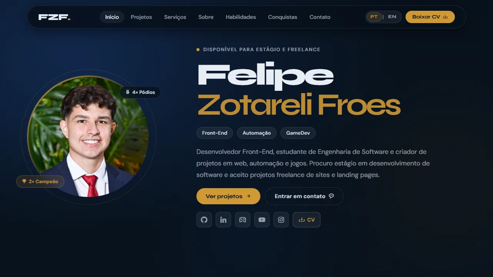

# Portfólio — Felipe Zotareli Froes

Portfólio pessoal publicado em **[felipezfroes.com](https://felipezfroes.com)**, em português e em
inglês ([felipezfroes.com/en/](https://felipezfroes.com/en/)). Reúne meus projetos de desenvolvimento web,
automação e jogos, com estudos de caso, serviços freelance, conquistas, formulário de contato e currículo.
A home tem dois atalhos discretos: um para recrutadores (projetos técnicos, habilidades, GitHub e CV) e
outro para clientes (serviços, exemplo real e pedido de orçamento).



## Tecnologias

- **HTML5** semântico, com metadados de SEO, Open Graph e dados estruturados (Schema.org)
- **CSS3** sem frameworks: variáveis, Grid, Flexbox e layout responsivo
- **JavaScript** simples, sem dependências: formulário com validação, galeria acessível e navegação
- **Dois idiomas** (pt-BR e en) com páginas próprias, `hreflang` recíproco e seletor PT | EN que mantém o contexto
- [Boxicons](https://boxicons.com) e Google Fonts (Syne e DM Sans)

## Estrutura

```text
├── index.html                  # página principal (português)
├── en/                         # versão em inglês
│   ├── index.html              # home em inglês
│   └── projects/<slug>/        # estudos de caso em inglês
├── styles.css                  # estilos compartilhados (tokens, componentes e responsivo)
├── js/main.js                  # formulário, navegação, seletor de idioma e analytics (textos PT/EN)
├── assets/                     # currículo em PDF
├── img/                        # foto de perfil e imagens de compartilhamento (img/og)
├── projetos/
│   ├── papotech-editor/        # estudos de caso (uma pasta por projeto)
│   ├── maniprotein/
│   ├── ecos-do-olimpo/
│   ├── chipre/                 # C.H.I.P.R.E. — Hackathon UniCesumar × Elotech
│   ├── relogio-das-consequencias/
│   ├── css/case-study.css      # estilos dos estudos de caso
│   ├── js/gallery.js           # galeria das páginas de projeto
│   └── img/                    # capturas de tela em WebP
├── docs/CONFIGURACAO.md        # Formspree, analytics, Search Console e publicação
├── docs/MIDIAS_PENDENTES.md    # origem de cada imagem e mídias que ainda faltam
├── sitemap.xml · robots.txt · .htaccess · 404.html
```

`projetos/login.html` e `projetos/esporte-fav.html` são páginas antigas mantidas para links externos;
`projetos/ecos.html` e `projetos/maniprotein.html` redirecionam para os novos estudos de caso.

## Como rodar localmente

Os estudos de caso usam URLs de pasta (`/projetos/ecos-do-olimpo/`), então use um servidor local em vez
de abrir o arquivo direto:

```bash
python -m http.server 5520
```

Depois acesse `http://localhost:5520` (português) ou `http://localhost:5520/en/` (inglês).

## Configuração

O formulário de contato está conectado ao Formspree (sem o ID, ele abre o e-mail do visitante). Os
assuntos de orçamento e automação mostram dois campos opcionais, e links podem pré-selecionar o assunto. Analytics e Search Console estão preparados, mas não ativados. Veja o passo a passo em
[`docs/CONFIGURACAO.md`](./docs/CONFIGURACAO.md), incluindo como adicionar novos projetos.

## Contato

- E-mail: felipefroes.dev@gmail.com
- LinkedIn: [/in/felipezfroesdev](https://www.linkedin.com/in/felipezfroesdev/)
- GitHub: [@felipezfroes](https://github.com/felipezfroes)
